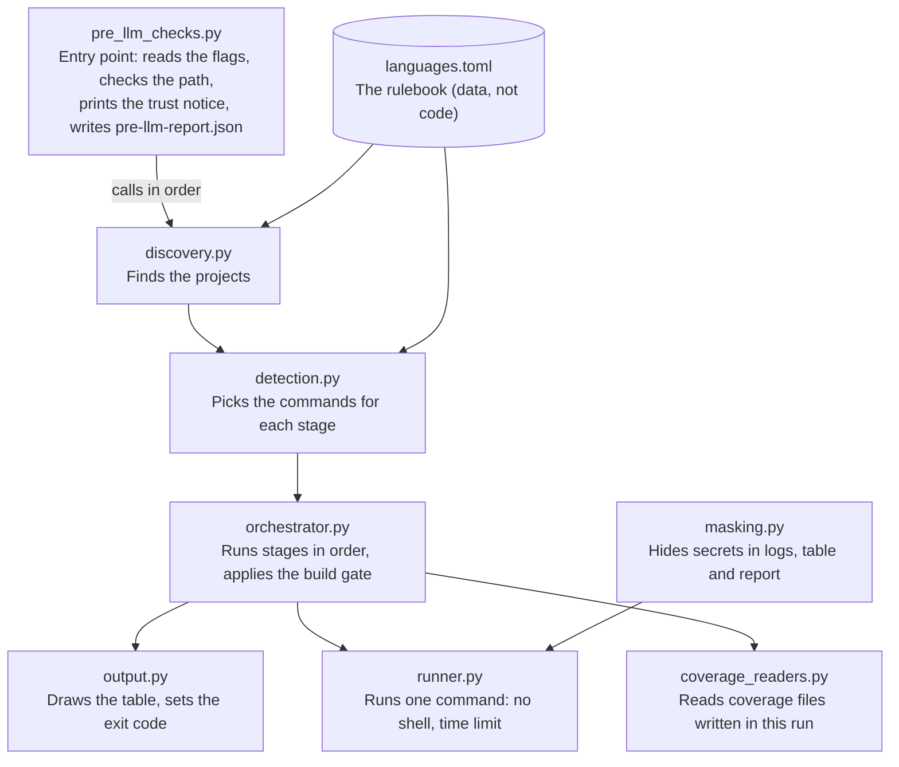
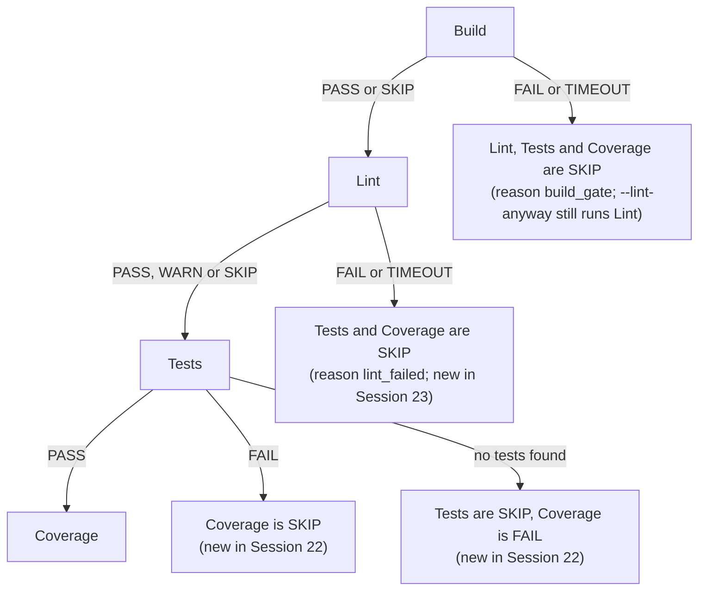

# Pre-LLM Checks: Handover

Oct 13, 2026 · @Rodaina Abdelbaky

## In one minute

Pre-LLM Checks is a small command-line tool that answers four questions about a codebase before an AI reviews it: does it build, does it pass its own linter, do its tests pass, and how much of it do the tests cover.

It does this by running the project's own tools (the scripts and configs the project already has), then writing two things: a table in the terminal for people, and a file called `pre-llm-report.json` for the AI to read. The tool itself uses no AI. It only collects facts.

Where things stand today:

- **Code**: about 4,700 lines of plain Python 3.11+, no extra packages. Repo: [rabdelbaky/SAT](https://github.com/rabdelbaky/SAT), branch `master` (latest commit 4954761, Session 21).
- **Languages**: 11 supported. 7 tested on real tools on Windows and Mac (Python, JavaScript/TypeScript, Java, Kotlin, Go, C#, Ruby). 4 still marked untested (Rust, PHP, Swift, C/C++).
- **Tests**: over 600 automated tests and about 110 tiny sample projects ("fixtures") with known expected results.
- **Built in**: 21 build sessions between 10 and 13 October 2026, each reviewed and tested by hand.
- **Open decisions**: two optional features (a coverage minimum and a `--strict` mode) are parked because they need a change to the spec first.

## Why it exists, and the rules it never breaks

An AI reviewer reads code, but it cannot tell whether that code even compiles. It may spend a whole review polishing something whose tests are already red. Running every language's tools by hand (npm, Maven, Gradle, pytest, go, dotnet...) across a repo with several projects is slow and easy to get wrong. So this tool runs them first and hands the AI a clean, structured summary of the facts.

Because the tool runs inside other people's code, safety came first. These "golden rules" shaped every design decision:

| Rule | What it means in practice |
| --- | --- |
| Read-only | It never edits your code, never installs packages, never runs auto-fixers or formatters. |
| Only project-defined tools | It runs only what the project itself declares: a script, a plugin, a config file, or the language's built-in command. It never guesses. A linter that is merely installed (for example only listed in devDependencies) is not enough. |
| No shell | Every command runs as a list of arguments (`shell=False`), which avoids shell-injection problems. |
| One allowed write | The only file it may ever change is `.gitignore`, and only if you pass `--add-gitignore`. It also writes its own logs into `.pre-llm/logs/`. |
| Secrets masked | Tokens, passwords, API keys and connection strings are hidden in the table, the report and the log files. |
| Clean paths | Paths in the report are relative to the repo root and always use forward slashes, on every OS. |
| Always a report | A report is written even after an error or Ctrl+C. |

**Trust warning.** The tool is read-only, but the scripts it runs are not: a project's `test` script can do anything. So the tool prints a one-line trust notice at the start of every run, and you should only run it on code you trust. `--dry-run` shows every command it would run without running anything. There is no sandbox in version 1.

## How to run it

You need Python 3.11 or newer and nothing else. There is nothing to install: you download the repo and run `pre_llm_checks.py`, pointing it at the folder you want checked.

Windows (PowerShell). Use `py -3`, because on some machines plain `python` is an older 3.10, which cannot run the tool:

```powershell
py -3 C:\tools\SAT\pre_llm_checks.py --path C:\code\my-repo --dry-run
py -3 C:\tools\SAT\pre_llm_checks.py --path C:\code\my-repo
```

Mac or Linux:

```bash
python3 ~/tools/SAT/pre_llm_checks.py --path ~/code/my-repo --dry-run
python3 ~/tools/SAT/pre_llm_checks.py --path ~/code/my-repo
```

The first line is a preview: it lists every command the tool would run, and runs none of them. The second line does the real check. Without `--path`, the tool checks the folder you are in.

What you get:

- **A table in the terminal**, one row per project, with a Build, Lint, Tests and Coverage cell each. Problems get a short Details line underneath.
- **`pre-llm-report.json`** in the folder you ran from (change it with `--output`). This is what you give the AI.
- **Full logs** of every command in `.pre-llm/logs/` inside the checked repo.

### The flags

| Flag | What it does |
| --- | --- |
| `--path` | Folder to check (default: current folder). |
| `--output` | Where to write the JSON report. |
| `--dry-run` | Show the plan, run nothing, write no report. |
| `--steps build,lint,tests,coverage` | Run only some stages. Leaving out `build` also turns off the build gate. |
| `--lint-anyway` | Still run Lint even if Build failed. |
| `--verbose` | Stream every command's output live. |
| `--timeout-build` / `-lint` / `-tests` / `-coverage` | Change a stage's time limit, e.g. `90s`, `30m`, `1h30m`. |
| `--tail-lines` | How many last lines of output to keep per command in the report (default 50). |
| `--config` | Use a different `languages.toml` rulebook. |
| `--add-gitignore` | Add `.pre-llm/` to the repo's `.gitignore`. |
| `--version` | Print the version. |

### Exit codes

Useful if the tool is called from a script or pipeline.

| Code | Meaning |
| --- | --- |
| 0 | Everything passed, or there were only warnings. |
| 1 | Something failed or timed out. |
| 2 | The tool itself hit an error: bad flag, bad path, broken config, internal crash. |
| 3 | No supported project found in the folder. |
| 130 | You pressed Ctrl+C. |

## How it works inside

A run goes through five steps, always in the same order. The diagram at the end of this section shows how the code files pass work to each other.

1. **Find the projects.** The tool walks the folder tree looking for build files (`package.json`, `pom.xml`, `pyproject.toml`, `go.mod`...). Each build file marks a project. A file belongs to the nearest build file above it, so in a monorepo a sub-project wins over the root. Folders like `node_modules`, `.git`, `build`, `dist`, `target`, `vendor` and `.venv` are skipped. Maven modules, Gradle subprojects, .NET solutions and Cargo workspaces are folded into their root project so they are not built twice.
2. **Work out what to run.** For each project and each stage, the tool looks for commands the project defines, in this order: scripts in the build file (e.g. `"lint"` in package.json; `lint:types` also counts), linter config files next to it (`.golangci.yml`, `.rubocop.yml`...), plugins in the build file (`maven-checkstyle-plugin`, `jacoco`...), and the language's built-in commands (`mvn test`, `go test ./...`). A `pre-llm.toml` file at the repo root can override any stage. Risky scripts are skipped and listed with the reason: names ending in `:fix`, `:watch`, `:dev`, `:serve`, `:e2e`, `:docker`, `:deploy`, and anything using `--fix` or `--write`.
3. **Run the commands safely.** Build, then Lint, then Tests, then Coverage. Each command runs with a time limit (Build 10 min, Lint 5 min, Tests 15 min, Coverage 15 min). On a timeout, or on Ctrl+C, the whole process tree is killed. Wrappers like `mvnw` and `gradlew` are used instead of `mvn` and `gradle` when the project has them.
4. **Decide each stage's result.** If Build fails, the other stages for that project are skipped (the "build gate"), because testing code that does not compile tells you nothing. Error text like "No module named" turns a failure into a `dependencies_missing` warning, since that is a setup problem, not a code problem. "0 tests ran" is never counted as a pass. Coverage is read only from report files written during this run, so an old file from last week cannot fake a number.
5. **Write the outputs.** The table goes to the terminal, the JSON report to disk, and secrets are masked on the way out.

### The code files

Each Python file has one job. The language knowledge does not live in code at all: it lives in `languages.toml`.

| File | Job | Lines |
| --- | --- | --- |
| `pre_llm_checks.py` | Entry point: reads the flags, checks the path, prints the trust notice, ties everything together, writes the report. | 846 |
| `discovery.py` | Finds the projects in the folder tree. | 535 |
| `detection.py` | Picks the commands each project defines for each stage, and reads `pre-llm.toml`. | 870 |
| `runner.py` | Runs one command safely: no shell, time limit, kills the process tree, decodes odd bytes without crashing. | 410 |
| `orchestrator.py` | Runs the stages in order, applies the build gate, turns raw results into statuses. | 787 |
| `coverage_readers.py` | Reads coverage files (JaCoCo, Cobertura, Istanbul, lcov, Go, llvm-cov, SimpleCov) and checks they are fresh. | 811 |
| `output.py` | Draws the terminal table, works out exit codes, records tool versions. | 371 |
| `masking.py` | Hides secrets in any text. | 62 |
| `languages.toml` | The rulebook: per language, its build files, script names, config files, built-in commands, coverage files and error phrases. | 718 |

**Languages are data, not code.** This is the most important design choice. For Go, for example, the rulebook says: a project is marked by `go.mod`; build is `go build ./...`; lint is `go vet` (or golangci-lint if configured); tests are `go test ./...`. Adding a language is mostly writing a new entry plus a few sample projects to prove it works. No Python change should be needed.



Read it top down: the entry point calls the four main modules in order, the rulebook feeds the first two, and the orchestrator hands each command to the runner and each coverage file to the coverage readers.

## Languages, and what was tested where

Seven of the eleven languages are "tested": every one of their sample projects gave exactly the expected result with the real tools installed. The other four are supported in the rulebook but show an `[untested]` label in the table, so nobody mistakes them for verified.

A language only becomes tested when all of its applicable sample projects pass: one that builds cleanly (`-ok`), one with a build error, one with a failing test, one with a lint error, one with no tests, and one with no linter.

| Language | Marked by | Tools it can run (only if the project declares them) | Tested? | Where it was verified |
| --- | --- | --- | --- | --- |
| Python | `pyproject.toml`, `requirements.txt` | pytest, ruff, flake8, pylint, mypy, pytest-cov | Yes | Windows, Mac, Linux cloud |
| JavaScript / TypeScript | `package.json` | package.json scripts, tsc, eslint, biome, jest, vitest, mocha (always via `npx --no-install`, so nothing is downloaded) | Yes | Windows, Mac, Linux cloud |
| Java | `pom.xml`, `build.gradle(.kts)` | Maven or Gradle compile and test, Checkstyle, PMD, SpotBugs, JaCoCo | Yes | Windows, Mac, Linux cloud |
| Kotlin | `build.gradle(.kts)` | Gradle, detekt, ktlint, JaCoCo | Yes | Windows, Mac (with JDK 21), Linux cloud |
| Go | `go.mod` | go build, go vet, go test, golangci-lint (always with `--fix=false`) | Yes | Windows, Mac, Linux cloud |
| C# / .NET | `*.sln`, `*.slnx`, `*.csproj` | dotnet build, dotnet format (check only), dotnet test, coverlet | Yes | Windows, Mac |
| Ruby | `Gemfile` | rspec, rubocop, standardrb (no fix), SimpleCov | Yes | Windows, Mac, Linux cloud |
| Rust | `Cargo.toml` | cargo build, clippy, test, tarpaulin | No | Linux cloud only (the Windows machine has no linker) |
| PHP | `composer.json` | phpunit, phpcs, phpstan, psalm, php-cs-fixer (dry run only) | No | Not on our machines |
| Swift | `Package.swift` | swift build and test, SwiftLint, swiftformat (lint only) | No | Mac needs full Xcode, Windows needs Visual Studio C++ tools; neither available |
| C / C++ | `CMakeLists.txt`, `Makefile`, `meson.build` | cmake, make, ninja, ctest | No | No sample projects yet |

Two things matter for colleagues reading this table:

- **Untested does not mean broken.** Rust, PHP and Swift all have sample projects and pass the "fake tool" tests (see How the work was done). Promoting them to tested only needs someone to run their sample projects with the real tools and confirm the results.
- **Missing toolchains show as WARN, not FAIL.** For example, Swift without Xcode, or Rust without the Windows linker, gives a warning that says what is missing. The tool never reports a code failure for a setup problem.

## Reading the results

The tool speaks to two readers. The terminal table is for a person who wants the answer at a glance. The JSON report is for the AI, which needs the details: the exact command, the source of that command, and the last lines of output.

### The terminal table

One row per project, one cell per stage. Each cell shows the worst result in that stage.

| Cell | Meaning |
| --- | --- |
| `PASS` | Every command passed. For Coverage the lowest line percentage is shown instead, e.g. `72.0%`. |
| `FAIL` | A command failed. This is a real code problem. |
| `TIMEOUT` | A command ran out of time. Counts as a failure. |
| `WARN` | Not a code failure: no linter configured, a tool not installed, dependencies missing, or no coverage data. |
| `SKIP` | Did not run: blocked by the build gate, nothing to run, no tests found, or the stage was not asked for. |
| `INTR` | Stopped by Ctrl+C. |

The difference between WARN and FAIL is the heart of the tool's honesty. A FAIL says "the code is broken". A WARN says "we could not check this, and here is why". A missing package or an uninstalled linter is never blamed on the code. Under the table, a Details line explains each non-pass cell, then any warnings, then a one-line summary.

### The JSON report

`pre-llm-report.json` is written on every real run (not on `--dry-run`). Even when the tool stops early, for example on a bad path, it still writes a report with `summary.status` set to `error` or `no_project`, so the AI always has something to read. A shortened example:

```json
{
  "schema_version": "1.0",
  "summary": {
    "status": "fail",
    "project_count": 1,
    "counts": {"pass": 2, "fail": 1, "timeout": 0, "warning": 1, "skipped": 0, "interrupted": 0},
    "generated_at": "2026-10-13T13:10:14+00:00"
  },
  "warnings": ["gitignore_missing"],
  "projects": [{
    "path": ".",
    "language": "python",
    "build_files": ["pyproject.toml"],
    "skipped_scripts": [],
    "commands": [{
      "stage": "tests",
      "command": ["pytest"],
      "source": "config",
      "status": "fail",
      "duration_s": 1.4,
      "output_tail": ["FAILED test_calc.py::test_add - assert 3 == 4", "1 failed, 2 passed"],
      "log_path": ".pre-llm/logs/_root_/tests-0.log",
      "findings": null,
      "reason": null
    }],
    "warnings": ["coverage_missing"]
  }],
  "environment": {"os": "Windows 11", "runners": {"pytest": "pytest 8.3.4"}}
}
```

| Part | What it tells the reader |
| --- | --- |
| `schema_version` | Version of the report's shape. Any change to the shape must bump it; a test enforces this. |
| `summary` | The overall result (`pass`, `fail`, `interrupted`, `error`, `no_project`), how many projects, how many table cells of each status, and when it ran (UTC). |
| `warnings` | Problems with the repo as a whole, like `gitignore_missing` or `no_project: <folder>` (source files with no build file). |
| `projects[]` | One entry per project: its folder, language, build files, and any scripts it deliberately skipped, with the reason. |
| `commands[]` | One entry per command: the stage, the command (secrets masked), where it came from (`script:<name>`, `config` for config files and plugins, `builtin`, or `override`), the status, how long it took, the last 50 lines of output, and where the full log is. |
| `findings` | Always `null` in version 1. Reserved for later, when parsers for JUnit XML or SARIF are added. |
| `environment` | The operating system and the version of each tool that actually ran, so a result can be reproduced. |
| `truncated` | Appears only if the report passed about 200 KB and output was trimmed to fit. |

Size is capped on purpose, because the report goes into an AI's context window: 50 lines of output per command (change with `--tail-lines`), each line cut at 500 characters, about 200 KB in total.

## Tricky situations it handles

Much of the work went into making the tool behave well when something unusual happens, and into never reporting a pass that is not real. Most cases below have a sample project in `tests/fixtures/` that proves it; the rest are covered by automated tests.

| Situation | What the tool does |
| --- | --- |
| The folder does not exist, or is a file | Prints an `ERROR:` line, exits with 2, still writes a report with status `error`. |
| No supported project in the folder | Says "No supported projects found", exits with 3, writes a report with status `no_project`. |
| A monorepo with several projects | One table row per project. Each project is independent: one failing does not stop the others. |
| Two languages in one folder | Two projects, one per language. |
| Two build files of one language in one folder | One project. `pyproject.toml` beats `requirements.txt`; `.sln` beats `.csproj`. Both are listed. |
| Source files with no build file, or an unsupported language (`.r`, `.scala`) | A `no_project` or `unsupported_extension` warning, not an error. |
| A linter listed in devDependencies but with no script or config | Not run. Being installed is not the same as being chosen by the project. |
| Risky scripts (`lint:fix`, `dev`, `deploy`, anything with `--fix`) | Skipped and listed in `skipped_scripts` with the reason. |
| The same command defined twice | Runs once. Different arguments count as different commands. |
| No linter at all | Lint shows WARN "no linter configured". Not a pass, not a failure. Tests still run. |
| A linter configured but not installed | Lint shows WARN "tool not installed: \<name>". Never a pass. |
| Dependencies not installed ("No module named", NuGet NU1101, missing `node_modules`) | WARN `dependencies_missing`. The tool never installs anything. |
| "0 tests ran" | SKIP `no_tests_found`, never a fake pass. Each language's "no tests" wording is in the rulebook. |
| The build fails | Lint, Tests and Coverage are skipped (reason `build_gate` in the report). `--lint-anyway` still runs Lint. |
| A command hangs | Killed at the time limit with its whole process tree, marked TIMEOUT. |
| You press Ctrl+C | The running command and its children are killed, the cell shows INTR, the report is still written, exit code 130. |
| Odd bytes or a foreign encoding in the output | Decoded as UTF-8 with replacement. Never crashes. |
| An old coverage file from a previous run | Ignored. Only files written during this run count. |
| No coverage file, but a percentage in the output | The percentage is read from the output instead. |
| A broken or empty coverage XML | Ignored without crashing. |
| Several coverage tools in one project | Never averaged. The table shows the lowest. |
| Python coverage set up in pytest's own settings (`addopts = --cov`) | Detected, so coverage is read instead of shown as missing. |
| A broken `pre-llm.toml` (e.g. `tests = 5`) | A clean `ERROR:` message and exit 2, not a Python crash. |

Windows and Mac differ in a few places, all handled: programs are found with their `.cmd` and `.exe` endings, process trees are killed with `taskkill` on Windows and a process-group kill on Mac and Linux, `/dev/null` becomes `NUL` on Windows, and backslashes in Windows override commands are kept.

## Known gaps

These are real limits on today's `master`. None of them breaks a normal run, but colleagues should know about them before relying on the tool. The first three were confirmed by actually running the tool; the next two were found by reading the code.

1. **Some secret formats are not masked.** `token=abc`, `password=abc`, `Bearer abc`, `user:password@host` and `?token=` in URLs are hidden. But a JSON-style `"password": "hunter2"`, a flag with a space (`--password hunter2`), and a bare GitHub (`ghp_...`) or AWS (`AKIA...`) key on its own line stay visible in the report and logs.
2. **An override can run a fixer.** If a repo owner writes `lint = "ruff check --fix ."` in `pre-llm.toml`, it runs as written. Overrides count as project-defined, so this follows the spec's wording, but it goes against the "never run fixers" rule in spirit.
3. **Projects behind a symlink are not found.** Symlinked folders are not followed. That is safe (no endless loops), but silent: the tool just says no project was found.
4. **Python 3.10 crashes at start.** The tool needs Python 3.11 but does not check the version first, so on 3.10 you get a Python error and no report. On Windows, use `py -3`.
5. **Ctrl+C during the folder scan.** Ctrl+C is handled cleanly while commands run. Pressing it earlier, while a very large repo is still being scanned, gives a Python error and no report.
6. **Four languages are untested.** Rust, PHP and Swift have sample projects but were not confirmed with real tools on our machines. C/C++ has no sample projects at all.

And these are left out of version 1 on purpose (spec section 13): running projects in parallel, filtering by language, checking only changed files, coverage thresholds, installing dependencies, CI integration, a sandbox, zip or git URL input, and parsers that turn tool output into structured `findings`.

## How it compares with the two other team tools

On 13 October 2026 this tool (SAT) was compared with two colleagues' tools that solve the same problem: Mohamed's [code-review-agent](https://github.com/mohamed-samy-pwc/code-review-agent) and Nouran's [pre-llm-checks](https://github.com/nouranabdelaal-pixel/pre-llm-checks). All three were also run on the same dummy project. SAT came out strongest overall, and two rounds of work (Sessions 20 and 21) then borrowed the best ideas from the other two.

All three share the same idea: four stages, only the project's own tools, a table for people and JSON for the AI, no AI inside. SAT's spec was in fact rebuilt from Nouran's original design.

|  | Mohamed | Nouran | SAT |
| --- | --- | --- | --- |
| Written in | Bash and PowerShell, two copies of the same logic | Python, one file of about 1,900 lines | Python, 8 modules of about 4,700 lines |
| Languages | 13 (adds Elixir, Scala) | 12 listed, 3 tested | 11, 7 tested on real tools |
| What it runs | A fixed command per language | Only what the project defines | Only what the project defines, more refined |
| Pass/fail rules | Strict gate: any FAIL stops; no tests = FAIL; coverage under 80% = FAIL | Setup problems are warnings | Setup problems are warnings |
| Timeouts and Ctrl+C | None | Timeouts | Timeouts and Ctrl+C |
| Secret masking | None | Report only | Report, terminal and logs |
| Automated tests | 125 checks plus clever "fake tool" tests | None | Over 600 tests and about 110 sample projects |

**What SAT borrowed (all done):** Python coverage read from pytest's own settings (found in the dummy run), summary counts and a timestamp in the report (Nouran), fake-tool tests and golden files so every language can be tested on any machine (Mohamed), a strict rule that any change to the report's shape bumps its version (Mohamed), and a proper README (both).

**What SAT deliberately did not take:** two scripts in two shell languages that must be kept in sync, committed `node_modules` folders, and commands that run even when the project did not ask for them.

## Two ideas waiting for a decision

Two of Mohamed's ideas were not built, because the current spec rules them out. They need a team decision, and then a short edit to `SPEC.md`, before any code is written.

| Idea | What it would do | Why it is parked |
| --- | --- | --- |
| Coverage minimum (`--min-coverage 80`, or `min_coverage` in `pre-llm.toml`) | Off by default. When set, coverage below the number turns the Coverage cell into FAIL, and the report shows the percentage next to the minimum. Could differ per language. | Spec section 9 says "No threshold in v1", and section 13 lists coverage thresholds as out of scope. |
| Strict mode (`--strict`) | Makes "no tests found" a FAIL instead of a SKIP or warning, for teams that want a hard gate. | The spec defines "nothing to run" and "no tests" as warnings, not failures. |

The question for the team is a product one: should this tool only report evidence (today's design, where judging is left to the AI and to people), or should it also be able to act as a pass/fail gate? Both ideas would be optional, so the default behaviour would not change either way.

## How the work was done

The tool was built in 21 short "sessions" between 10 and 13 October 2026. The rule was simple: one session builds one piece, and that piece must pass a hands-on check before the next one starts.

### Who did what

- **A coding agent** (Claude Code on the Mac) wrote the code for each session from a self-contained prompt that named the exact files to touch. It was told: "Code only. Do not run it; I will."
- **Rodaina** ran every check by hand, on Windows PowerShell and on the Mac, and pasted back only the lines that failed.
- **A reviewer** (Claude in this project) read each session's code against `SPEC.md` and `CONTEXT.md`, ran the tests and sample projects in a Linux cloud copy, and wrote the next fix prompt. From Session 13 on, the reviewer only reviewed and wrote prompts; it never changed the code itself. Every problem a review found, even a small one, went into that same session's fix prompt.

The reviewer looked especially hard for "vacuous passes": checks that report success even though nothing really ran. Several were found and fixed along the way, for example a Ctrl+C check that passed only because the test program exited with code 130 by itself.

### The sessions

| Sessions | What was built |
| --- | --- |
| 1 to 3 | Skeleton, the `languages.toml` loader, report writer with masking and size caps, command-line flags and path checks, the trust notice. |
| 4 to 5 | Finding projects in a folder tree (monorepos, skip lists, priorities); choosing commands and reading `pre-llm.toml`. |
| 6 to 7 | The safe command runner (no shell, timeouts, killing process trees, Ctrl+C); running the stages in order with the build gate. |
| 8 to 9 | Coverage readers with the freshness check; the terminal table, exit codes and environment block. |
| 10 to 19 | One language per session: Python, JS/TS, Java, Kotlin, Go, C#, Rust, PHP, Ruby, Swift. Each added detection rules and sample projects, then fixes after review. |
| Final fixes | A full verification of `master` found 14 issues (log files not masked, no report on early exits, `--add-gitignore` doing nothing, and others). All 14 were fixed and re-checked. |
| 20 | Python coverage read from pytest's own `addopts` settings. |
| 21 | Summary counts in the report, fake-tool tests with golden files, the report version guard, and the README. |

### The branch flow

Each session lived on its own Git branch, so `master` only ever held work that had passed:

1. On the Mac, merge the latest `master` into the session branch (for example `session-14`).
2. Give the agent the session's prompt; it writes the code on that branch. Commit and push.
3. Test by hand on Windows and on the Mac. If anything fails, the reviewer writes a fix prompt and the loop repeats on the same branch.
4. Once everything passes, move `master` forward to the session branch (`git merge --ff-only`) and push from the Mac. Pushing from the Windows machine was failing, so the Mac did all pushes.

Every review and every agent prompt is kept in the project's `reviews/` folder (`session-N-review.md`, `session-N-agent-prompt.md`), so any decision can be traced back to the reason it was made.

### How the tool is tested

| Kind of test | What it checks | How to run |
| --- | --- | --- |
| Automated tests (pytest) | Every module on its own, plus the whole tool end to end. Over 600 tests. | `py -3 -m pytest -q` (Windows) or `python3 -m pytest -q` (Mac) |
| Fake-tool tests with golden files | Replace the real command runner with a stand-in, so every language's planning and statuses are checked on any machine, even without Rust, PHP, Swift or a C++ compiler. The expected output is saved in `tests/golden/`. | Part of pytest |
| Report shape guard | Fails if the report's shape changes without bumping `schema_version`. | Part of pytest |
| Manual check scripts | Run the real tools against the sample projects and compare with `tests/fixtures/EXPECTED.md`. | e.g. `py -3 tests/manual_python_check.py` |

The tool itself needs nothing installed. pytest is only needed to run the tests.

## Technical deep dive

The sections below are for tech leads who want to know exactly how the tool behaves and why. They are based on the code on `master` (4954761), mainly `orchestrator.py`, `runner.py`, `coverage_readers.py`, `masking.py` and `languages.toml`.

### Part 1: how one stage's result decides the next

The four stages always run in the same order: Build, Lint, Tests, Coverage. Only a real Build failure stops the others today. Three more rules are decided: two arrive in Session 22 and one in Session 23.

| If this happens | What happens next | Why | Status |
| --- | --- | --- | --- |
| Build is FAIL or TIMEOUT | Lint, Tests and Coverage are SKIP (reason `build_gate`). `--lint-anyway` still runs Lint. | Code that does not compile cannot be tested; any test result would be noise. | Today |
| Build is SKIP (the language has no build step, like Python, Ruby or PHP, or the project defines none) | Lint, Tests and Coverage still run. | SKIP means "nothing to check here", not "broken". Gating on it would mean Python projects are never tested. | Today |
| Lint is FAIL or TIMEOUT | Tests and Coverage are SKIP (reason lint_failed). Lint WARN or SKIP (no linter, tool not installed, dependencies missing) changes nothing. | Code that fails its own agreed checks is not ready for testing. A missing linter is a setup gap, not a code failure, so it does not block. | Decided, coming in Session 23 (today Tests and Coverage still run) |
| Tests are FAIL | Coverage becomes SKIP. | A coverage number from a failing test run is misleading: failed tests stop early and leave code uncovered. | Decided, coming in Session 22 (today Coverage still runs) |
| No tests were found | Tests are SKIP (reason `no_tests_found`) and Coverage becomes FAIL. | A project with no tests has, by definition, no coverage. That should be visible as a failure, not hidden as a skip. | Decided, coming in Session 22 (today Tests are SKIP and Coverage is judged on its own) |



Read it top down: a stage only blocks what comes after it on the paths drawn to the right; every other result lets the next stage run.

Two details worth knowing:

- **The Coverage stage usually runs the tests again**, this time with coverage switched on (`pytest --cov`, `go test -coverprofile`, `jest --coverage`...). That is how coverage tools work: they watch the code while the tests run. It also means a slow test suite costs twice.
- **Leaving `build` out of `--steps` turns the gate off.** That is useful when you know the build is broken but still want lint results.

### Part 2: what "Build" means in each language

"Build" means different things in different languages. In compiled languages it means "does the code compile". In interpreted languages (Python, Ruby, PHP) there is no compile step, so Build is normally SKIP and the other stages carry the evidence.

| Language | Build command the tool runs | Notes |
| --- | --- | --- |
| Java (Maven) | `mvn compile` | Compiles only. Uses `mvnw` if the project has it. |
| Java / Kotlin (Gradle) | `gradle assemble` | Not `gradle build`, because that also runs tests and lint, so a failing test would look like a Build failure and the gate would hide it. Uses `gradlew` if present. |
| Go | `go build -o /dev/null ./...` | Compiles every package but writes no program file into the project. `/dev/null` becomes `NUL` on Windows. |
| C# / .NET | `dotnet build <solution or project>` | The `.sln` wins over `.csproj` when both exist. |
| Rust | `cargo build --workspace` | Builds the whole workspace once. |
| Swift | `swift build` | Needs full Xcode on Mac or Visual Studio C++ tools on Windows; without them it is WARN, not FAIL. |
| C / C++ | `cmake --build .`, `make` or `ninja` | Depending on which build file exists. Untested. |
| JavaScript / TypeScript | The project's own `build` script, or `tsc --noEmit` when there is a `tsconfig.json` | `tsc --noEmit` type-checks without writing files. With no build script and no TypeScript, Build is SKIP. |
| Python, Ruby, PHP | None | Build is SKIP (`nothing_to_run`). Nothing is gated. |

How a Build result is decided:

- **PASS**: the command exited with code 0.
- **FAIL**: it exited with a non-zero code. This turns on the build gate.
- **TIMEOUT**: it ran past 10 minutes (change with `--timeout-build`). Also turns on the gate.
- **WARN**: the build tool is not installed (`tool_not_installed`), or the error text shows missing dependencies (for example Gradle's "Could not resolve all artifacts" or NuGet's NU1101). These are setup problems, not code problems, so they do not turn on the gate.
- **SKIP**: there is nothing to run for this language or project.

### Part 3: linting

A linter reads source code without running it and flags problems: likely bugs (an unused variable, a value that can be null), risky patterns, style rules the team agreed on, and in some cases type errors. Tests show that the code does what it should. Lint shows how the code is written. An AI reviewer benefits from both, because lint output points at exact files and lines.

| Language | Lint tools the tool knows | What they focus on | Runs when |
| --- | --- | --- | --- |
| Python | ruff, flake8, pylint | Bugs, unused code, style (PEP 8) | The project has the tool's config file or `[tool.ruff]`-style table in `pyproject.toml` |
| Python | mypy | Type errors | Same |
| JS / TS | eslint, biome, or a `lint` script | Bugs, risky patterns, style | Config file next to `package.json`, or a `lint` script |
| Java | Checkstyle, PMD, SpotBugs | Style rules; code smells; bug patterns found in compiled code | The plugin is declared in `pom.xml` or the Gradle build file |
| Kotlin | detekt, ktlint | Code smells and complexity; formatting and style | The Gradle plugin is declared in the build file |
| Go | `go vet`, or golangci-lint | Suspicious code (`go vet` ships with Go, so every Go project has a linter); golangci-lint bundles dozens of linters | `go vet` always; golangci-lint when the project has `.golangci.yml` |
| C# | `dotnet format --verify-no-changes` | Formatting and analyzer rules | Always (built into .NET) |
| Rust | `cargo clippy` | Bugs, slow or non-idiomatic code | Always (ships with Rust) |
| PHP | phpcs, phpstan, psalm, php-cs-fixer | Style; type and logic errors | The tool's config file is next to `composer.json` |
| Ruby | rubocop, standardrb | Style and bugs | The tool's config file is next to the `Gemfile` |
| Swift | SwiftLint, swiftformat, swift-format | Style and formatting | The tool's config file is in the project |

**Why only tools the project defines.** Every team configures its linters differently: which rules are on, how strict, which files are excluded. If the tool picked a linter itself, it would judge the code by rules the team never agreed to, and the AI would get hundreds of irrelevant complaints. So the rule is: if the project has not chosen a linter, Lint shows WARN "no linter configured". That is honest evidence too: it tells the reviewer this code has no automated style or bug checks.

**Why fixers never run.** Many linters can also fix code (`--fix`, `--write`, `php-cs-fixer fix`). That would change the user's files, which breaks the read-only rule. So the tool runs them in check-only mode (`golangci-lint run --fix=false`, `dotnet format --verify-no-changes`, `php-cs-fixer fix --dry-run`, `standardrb --no-fix`) and skips any project script whose name or arguments show it would fix files.

### Part 4: coverage

Coverage answers "how much of the code did the tests actually execute?". A coverage tool attaches to the program while the tests run and records which lines (and sometimes which branches of an `if`) were reached. At the end it writes a report file. **Line coverage** is the share of lines that ran at least once; **branch coverage** is the share of decision paths taken. High coverage does not prove tests are good, but low coverage proves large parts of the code are never checked.

The tool does not measure coverage itself. It runs the project's own coverage tool, then reads the report file that tool wrote.

| Language | Coverage tool | Command the tool runs | Report file it reads | Format |
| --- | --- | --- | --- | --- |
| Python | coverage.py via pytest-cov | `pytest --cov --cov-report=xml` (or `pytest --cov-report=xml` when `--cov` is already in pytest's `addopts`) | `coverage.xml` | Cobertura XML |
| JS / TS | Jest (Istanbul inside), or a `coverage` script (e.g. c8, nyc) | `jest --coverage --coverageReporters=json-summary`, or the script | `coverage/coverage-summary.json`, `coverage/lcov.info` | Istanbul JSON, lcov |
| Java | JaCoCo | `mvn jacoco:report` or `gradle jacocoTestReport` | `target/site/jacoco/jacoco.xml`, `build/reports/jacoco/test/jacocoTestReport.xml` | JaCoCo XML |
| Kotlin | JaCoCo | `gradle jacocoTestReport` | `build/reports/jacoco/test/jacocoTestReport.xml` | JaCoCo XML |
| Go | Go's built-in cover tool | `go test -coverprofile=coverage.out ./...` | `coverage.out` | Go cover profile |
| C# | coverlet | `dotnet test --collect:"XPlat Code Coverage"` | `TestResults/*/coverage.cobertura.xml` | Cobertura XML |
| Rust | cargo-tarpaulin | `cargo tarpaulin --out Xml` | `cobertura.xml` | Cobertura XML |
| PHP | PHPUnit (with Xdebug or PCOV) | `phpunit --coverage-clover clover.xml` | `clover.xml` | Clover XML |
| Ruby | SimpleCov (started by the test run) | `bundle exec rspec` | `coverage/.last_run.json` | SimpleCov JSON |
| Swift | llvm-cov | `swift test --enable-code-coverage` | `.build/*/debug/codecov/*.json` | llvm-cov JSON |
| C / C++ | gcov / lcov | Project-defined | `lcov.info`, `coverage.xml` | lcov, Cobertura |

How the tool reads the result, step by step:

1. It notes the time just before the Coverage stage starts.
2. After the command finishes, it looks for the report files listed for that language in `languages.toml`.
3. **Freshness check:** a file older than the stage start is ignored as stale (warning `coverage_stale`). This stops an old report from last week producing a fake number.
4. It works out the format from the file's contents, parses it, and takes line coverage (and branch coverage when the format has it). A broken or empty file gives `coverage_unreadable`, never a crash.
5. If no fresh file was found, it looks for a percentage in the command's output (for example pytest's `TOTAL ... 85%` line or Go's `coverage: 85.3% of statements`).
6. If there is still nothing, Coverage is WARN `coverage_missing`.
7. If several files are found, the numbers are never averaged. The table shows the lowest one, and the report lists each.

There is no minimum percentage in version 1: the tool reports the number and leaves the judgement to people and the AI (see "Two ideas waiting for a decision").

**About Kover (Kotlin):** the tool does not read Kover reports today; Kotlin coverage is JaCoCo only. Kover can write a JaCoCo-style XML report, so adding it should mostly be a new rule in `languages.toml` plus sample projects. That last point comes from Kover's documentation and has not been tested here.

### Part 5: the engine

**Discovery (`discovery.py`).** The tool walks the folder tree once. Every file with a known build-file name marks a project for that language. Each source file is owned by the nearest build file above it, so in a monorepo `services/api/package.json` owns `services/api/src`, not the root. Skip folders (`node_modules`, `.git`, `target`, `build`, `dist`, `.venv`, `vendor`, `bin`, `obj` and more) are never entered, which keeps the scan fast and avoids checking third-party code. Multi-module builds (Maven `<module>`, Gradle `settings.gradle`, a `.sln`, a Cargo workspace) are folded into their root, because the root build already builds them. Source files with no build file give a `no_project` warning instead of being silently ignored.

**Detection (`detection.py`).** For each project and stage it collects candidate commands from the four sources (scripts, config files, plugins, built-ins) as described in `languages.toml`, removes risky ones, removes exact duplicates, then applies any `pre-llm.toml` override. JavaScript tools always run through `npx --no-install`, so a missing tool is reported, never downloaded.

**Running a command (`runner.py`).**

- **No shell.** Commands run as argument lists with `shell=False`. A file name containing `; rm -rf` is just a strange file name, never a second command.
- **Finding the program.** `shutil.which` finds the real executable, including `.cmd` and `.exe` on Windows. Wrappers (`mvnw`, `gradlew`) win over global installs. If nothing is found, the result is `tool_not_installed` (WARN), not a crash and not a pass.
- **Time limits.** Each stage has its own limit (Build 10 min, Lint 5 min, Tests 15 min, Coverage 15 min). When it runs out, the tool kills the **whole process tree**, not just the first process. That matters because `npm test` starts node, which may start more processes; killing only npm would leave the rest running. On Mac and Linux each command starts in its own process group, which is killed at once. On Windows the tool calls `taskkill /T /F`.
- **Ctrl+C.** Handled the same way: the tree is killed, the stage is marked `interrupted`, the report is still written, exit code 130.
- **Output.** Read as raw bytes and decoded as UTF-8 with replacement characters, so a tool printing odd bytes can never crash the run. Full output goes to `.pre-llm/logs/`; the last lines go into the report.

**Statuses (`orchestrator.py`).** Each stage starts as `pass` and only gets worse: a `fail` or `timeout` beats a warning, which beats a pass. A failed command whose output matches a language's "dependencies missing" phrases (from `languages.toml`) is turned into `dependencies_missing`, so a missing package is never blamed on the code. A test run whose output matches the language's "no tests ran" patterns, and none of its "tests ran" patterns, becomes SKIP `no_tests_found`.

**Secret masking (`masking.py`).** Four patterns replace the secret part with `***` and keep the rest readable: `Bearer <token>`; `key=value` or `key: value` where the key is a word like password, token, api\_key, secret\_key or private\_key; passwords in URLs (`user:***@host`); and secrets in URL query strings (`?token=***`). Masking is applied to commands, output, log files, the table and the report. Known misses are listed under Known gaps.

**The report (`pre_llm_checks.py`, `output.py`).** The JSON has a fixed shape with `schema_version` "1.0". A test (`tests/test_report_schema.py`) compares the shape with a saved copy and fails if it changes without the version being bumped, so the AI side can rely on it. Sizes are capped for the AI's context window: 50 lines per command, 500 characters per line, about 200 KB in total, with `truncated: true` if anything was trimmed. All paths are relative to the repo root with forward slashes, so a report from Windows and one from Mac look the same. Even on an early error the report is written, with `summary.status` set to `error` or `no_project`.

## Questions tech leads are likely to ask

| Question | Short answer |
| --- | --- |
| Why not just run the CI pipeline? | Many repos have no CI, or CI that only covers part of the code. This runs locally in one command on any repo, with no setup, and gives the AI a structured summary instead of raw CI logs. |
| Why Python with no packages? | It runs on any machine that has Python 3.11, with nothing to install, which fits the "never install anything" rule. The TOML reader is built into Python 3.11 (`tomllib`). |
| Is it safe to run on an unknown repo? | No. The tool itself is read-only, but the repo's own scripts can do anything. That is why it prints a trust notice and offers `--dry-run`. A sandbox is out of scope for version 1. |
| How do you guarantee it never changes code? | No fixers or formatters, check-only flags on every linter, risky scripts skipped, `npx --no-install`, and manual checks that run real linters on sample projects and confirm the source file is unchanged afterwards (Go, C#, PHP, Ruby). Its only writes are its own logs, the report, and `.gitignore` with `--add-gitignore`. |
| Why didn't it run eslint? It's installed. | Installed is not the same as chosen. The project needs a config file or a lint script. Otherwise Lint is WARN "no linter configured". |
| Why is Build SKIP for my Python project? | Python has no compile step. Lint, Tests and Coverage still run. |
| Why WARN and not FAIL when a tool is missing? | A missing tool or package is a setup problem on the machine, not a fault in the code. FAIL is reserved for problems the code owner must fix. |
| How do I know a PASS is real? | Every command's exit code, duration and last output lines are in the report. Test runs that ran zero tests become SKIP, and old coverage files are ignored. |
| Why is coverage the lowest number, not the average? | Averages hide weak spots. If the backend has 85% and the frontend 20%, the reader should see 20%. All numbers are in the report. |
| Why not use Gradle `build` instead of `assemble`? | `build` also runs tests and lint, so a failing test would show as a Build failure and the gate would skip the Tests stage that explains it. |
| What happens with a monorepo? | Each project is found, run and reported on its own, one table row each. One failing does not stop the others. |
| How do I add a language? | Add an entry in `languages.toml`, add sample projects and their expected results, add a golden file. No Python change should be needed. |
| What if a command hangs? | It is killed with its whole process tree at the stage's time limit and marked TIMEOUT, which counts as a failure. |
| What does the AI actually get? | `pre-llm-report.json`: per project and per command, the status, the command, where it came from, how long it took, and the last 50 output lines, all with secrets masked and capped at about 200 KB. |
| Is the report format stable? | Yes. It carries `schema_version`, and a test fails if the shape changes without bumping it. |
| How was it tested? | Over 600 automated tests, about 110 sample projects with expected results, fake-tool tests that cover every language on any machine, and manual runs with real tools on Windows and Mac for 7 languages. |
| Can it fail a pipeline on low coverage or no tests? | Low coverage: not yet, a coverage minimum is parked pending a spec change. No tests: yes once Session 22 lands, Coverage becomes FAIL, which makes the exit code 1. |
| Does it run projects in parallel? | No. Version 1 runs one project at a time, so output and timeouts stay simple and predictable. |
| Does it parse lint errors into structured findings? | Not yet. `findings` is reserved in the report and is `null` today. The AI reads the output lines instead. JUnit XML and SARIF readers are the planned first step. |

## Questions to settle with colleagues

- [ ] Should the tool stay evidence-only, or also offer an optional pass/fail gate (coverage minimum, `--strict`)? Either needs a spec change first.
- [ ] Who can run the Rust, PHP and Swift sample projects with the real tools, so those languages can be marked tested?
- [ ] Do we want sample projects for C/C++, or drop it from the supported list for now?
- [ ] Should the remaining secret formats (JSON style, `--password value`, bare `ghp_` and `AKIA` keys) be masked before wider use?
- [ ] Should an override in `pre-llm.toml` be allowed to use `--fix`, or should the tool refuse it?
- [ ] Where will the tool run day to day: on a developer's machine, or later inside CI (out of scope for version 1)?

## Glossary

| Word | Meaning |
| --- | --- |
| Project | A folder with a build file. One project per folder per language. |
| Build file | The file that marks a project, such as `package.json`, `pom.xml` or `go.mod`. |
| Stage | One of the four checks: Build, Lint, Tests, Coverage. |
| Project-defined tool | A command the project itself declares: a script, a plugin, a config file, or the language's built-in command. The only kind the tool runs. |
| Override | A command written in `pre-llm.toml` that replaces what would have been found. |
| Rulebook | `languages.toml`, where all language knowledge lives. |
| Fixture | A tiny sample project with a known expected result, used for testing. |
| Golden file | A saved copy of the expected output, compared on every test run. |
| Build gate | If Build fails, the other stages of that project are skipped. |
| Tested / untested | Tested means every sample project for that language gave the expected result with real tools. |
| Output tail | The last lines of a command's output, kept in the report. |
| Trust notice | The line printed at the start of every run, warning that the project's own scripts are about to run. |
| Vacuous pass | A check that says "pass" although nothing really ran. The tool, and its reviews, are built to avoid these. |

## Sources

- Code and README: [rabdelbaky/SAT](https://github.com/rabdelbaky/SAT), `master` at 4954761
- Design: `SPEC.md`, `CONTEXT.md`, `BUILD_SESSIONS.md` in the repo
- Reviews in the project folder: `reviews/three-repo-comparison.md`, `merge-strengths-plan.md`, `edge-cases.md`, `platform-and-edge-checks.md`, `final-verification-review.md`, and each `session-N-review.md`
